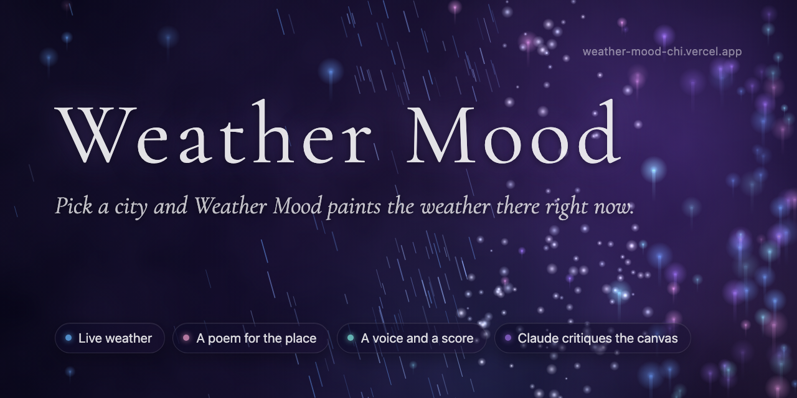

# Weather Mood

Weather Mood turns any city's live weather into a generative canvas with a poem, a voice and a score. Then Claude looks at a screenshot of its own work, critiques it against the weather, and redraws it while you watch, three rounds at most.

**Try it:** [weather-mood-chi.vercel.app](https://weather-mood-chi.vercel.app)



## What you will see

1. **Pick a city.** Type a name or press the random button. The current weather comes from Open-Meteo.
2. **The canvas paints itself.** Claude reads the weather and designs a full-screen scene for that place and moment: the colours of the sky, how particles fall or drift, glow, cloud texture, ripples or lightning.
3. **A poem appears.** Four to six lines in English, written for that city in that weather, then read aloud in the city's own language over music and ambient sound generated for the moment.
4. **Claude reviews its own work.** A short line under the search bar narrates it: "Round 2 of 3: the grey feels flat for a humid afternoon, adding amber". Each revision fades in over two seconds. It stops when the piece passes, after three rounds, or after four minutes, and if a revision came out worse, it goes back to the best version. Press Skip to stop it at any point.

If your device asks for reduced motion, the review loop does not run. If Claude declines or replies with something unusable, the page uses a hand-written scene for that kind of weather; if Claude cannot be reached at all, the canvas is drawn from the weather data alone.

## How the self-critique works

After the first draft is on screen, the page waits three seconds for the particles to settle, takes a 768 by 432 screenshot of the canvas and sends it to Claude with the weather and the scene's settings.

Claude is asked to review it as someone else's work, and to name at least one concrete defect or say why there is none. It scores five things from 1 to 5: whether the palette fits the temperature and the conditions, whether the particle density suits the weather, whether the poem will be readable over its part of the frame, whether the eye has somewhere to rest, and whether it feels like this city rather than anywhere with this weather. It gives one sentence of evidence for its lowest score, writes one sentence for the viewer, and picks up to four named adjustments, each small or large, from a fixed list: warmer, cooler, lighter, darker, more or fewer particles, bigger or smaller particles, faster, slower, calmer behind the poem, add or remove glow, more or less cloud, softer or sharper particles.

Claude does not decide whether its own work passes. The code does: the piece is accepted only if every score is at least 4. Separate arithmetic checks on the screenshot (a blank frame, a frame too dark or too washed out to read, a frame that has turned to noise) force a revision whatever Claude scored. Claude never writes a setting itself: the server turns each adjustment into numbers in code (`lib/critique/patch.ts`), and every result is clamped to the renderer's safe ranges before it is drawn.

Each round scores the version on screen, so the loop never ends on a revision nobody has scored: it keeps the best-scoring version and rolls back to it if the last one scored lower.

## What is tested

377 tests in 28 files, all run in CI on every pull request, with no network calls. Every Claude test uses a real SDK client whose network layer is stubbed, so the SDK's own request building and structured-output parsing run.

| Area | Tests | Covers |
|---|---|---|
| Self-critique | 147 | The critique route (token, round cap, image limits, spend cap, verdicts, adjustments), every adjustment knob (its fields, direction, small against large, clamp limits), the output schema's size and shape, cost-abuse cases (concurrent requests, per-address limits, expired tokens, a shared store that is down), capture, the browser loop's stop conditions and best-version rollback, the ticker, and the offline eval |
| Director | 25 | Structured outputs, refusal, truncation and malformed replies falling back cleanly, the model setting, and the prompt |
| Audio and cost controls | 37 | Visit tokens, single-use audio grants, rate limits, the daily spend cap, and audio playback |
| Canvas and weather | 128 | Weather classification and edge cases, normalisation, palettes, particles, and the weather pipeline end to end |
| Interface | 40 | City search, mute, poem overlay and weather panel |

**Critic evals.** `evals/critic-bad-frames/` has eight synthetic frames with expected verdicts: blank, all black, white on white, over-dense clutter, a good frame, and three legitimate controls (a dark storm, a bright snowfall, the renderer at its particle limit) that must not be flagged. Offline, the arithmetic checks get all 8 of 8 right. The live number, Claude's verdicts on the five frames that have an expected verdict, is pending: nobody has run `npm run eval:critic -- --live` yet (about 9 cents).

## Cost Controls

A visit makes one Claude call to design the piece, up to three Claude calls to critique it, and three ElevenLabs calls for the audio.

**What a visit costs.** The director runs on Claude Sonnet 5.5 ($2 / $10 per million input / output tokens) and costs about 3 cents a visit. The critic runs on Claude Haiku 5.5 ($0.10 / $0.50) and costs under a tenth of a cent a round (measured at about 3,100 input and 800 output tokens, the 768 by 432 screenshot being about 420 of the input), so about 4 cents of Claude per visit with all three rounds. ElevenLabs comes on top and is still the larger share. The spend cap reserves rounded-up figures: 4 cents for the director, 2 cents per critique round, 8 for music, 2 for ambience and 3 for narration, 23 cents for a full visit.

Five controls keep a public deployment bounded:

- **Visit tokens.** `/api/mood` returns a short-lived signed token. The music, sfx, narrate and critique routes refuse any request without one (401). Each token is good for one call per audio route (a replay gets 409) and three critique rounds (a fourth gets 429), counted on the server. So no paid route can be used as an open proxy: every call costs the caller a mood generation first. Set `VISIT_TOKEN_SECRET` in production; without it those routes return 503 rather than run unprotected.
- **Per-visitor limits.** `/api/mood` allows 4 generations per 10 minutes and 12 per day per IP. `/api/critique` allows 12 per 10 minutes and 36 per day per IP, so one address can spend at most 72 cents a day on critiques.
- **Image limits.** The critique route accepts only a 768 by 432 JPEG of at most 150 KB, checked on the decoded bytes.
- **Daily spend cap.** Each paid route reserves its estimated cost against a daily total before it calls upstream. Past `WEATHER_MOOD_DAILY_CAP_CENTS` (default 1000, so $10, about 43 full visits) paid routes return 503 and the page falls back to visuals drawn from the weather data and silence.
- **Shared state.** With `UPSTASH_REDIS_REST_URL` and `UPSTASH_REDIS_REST_TOKEN` set, the limits, grants, critique rounds and cap are shared across serverless instances. Without them each instance keeps its own counters, which is a much weaker bound, and the logs say so. If Upstash is configured but unreachable, critique rounds are refused rather than counted per instance.

Set a hard spend limit at the provider as well (Anthropic console, ElevenLabs plan). These controls bound a bad day; they are not a substitute for a provider-side cap.

## For developers

### Tech stack

- **Framework:** Next.js 14 (App Router), TypeScript in strict mode, Tailwind CSS
- **Rendering:** Canvas 2D with simplex-noise
- **Claude:** `@anthropic-ai/sdk` with `messages.parse` and zod schemas (structured outputs). Two roles, set in `lib/claude/config.ts`: the director (Claude Sonnet 5.5) writes the poem and designs the scene, voice and score directions; the critic (Claude Haiku 5.5) reviews screenshots. The critic was moved off Sonnet 5.5 after production showed 62 to 94 seconds a round, but that time matches the API spending about a minute on the critic's output schema and then refusing it as too complex, which production logs show on both models: the critic had never actually run. With the smaller schema, `scripts/probe-critique-schema.mts` measured one critique at 6.8 and 8.7 seconds on Haiku 5.5 and 4.3 seconds on Sonnet 5.5 (12 Oct 2026). Override with `WEATHER_MOOD_DIRECTOR_MODEL` and `WEATHER_MOOD_CRITIC_MODEL`.
- **Audio:** ElevenLabs REST API via `lib/elevenlabs/client.ts` for narration, music and ambience. There is no in-browser synthesiser; an earlier Web Audio synth was removed.
- **Weather:** Open-Meteo weather and geocoding (no key needed)
- **Screenshot checks:** `jpeg-js` decodes the critic's JPEG on the server for the pixel checks
- **Testing:** Vitest and React Testing Library
- **Hosting:** Vercel, with optional Upstash Redis for shared limits

### Getting started

You need Node.js 18 or later and npm. API keys are optional: without `ANTHROPIC_API_KEY` there is no poem or critique and the canvas is drawn from the weather data alone; without `ELEVENLABS_API_KEY` it is silent.

```bash
git clone https://github.com/cla1redonald/weather-mood.git
cd weather-mood
npm install
cp .env.example .env.local   # then add your keys
npm run dev                  # http://localhost:3000
```

### Scripts

- `npm run dev`: development server
- `npm run build`: production build
- `npm run start`: serve the production build
- `npm run lint`: ESLint
- `npm run typecheck`: TypeScript
- `npm test`: Vitest (`npx vitest run` for a single pass)
- `npm run eval:critic`: the critic eval, offline; add `-- --live` to include the model (costs money)
- `node --env-file=.env.local --import tsx scripts/probe-critique-schema.mts`: one live critique per critic model, printing the outcome, elapsed seconds, scores, adjustments and usage (under 2 cents)

### Environment variables

`.env.example` lists every variable with comments: `ANTHROPIC_API_KEY`, `ELEVENLABS_API_KEY`, `WEATHER_MOOD_DIRECTOR_MODEL`, `WEATHER_MOOD_CRITIC_MODEL`, `VISIT_TOKEN_SECRET`, `WEATHER_MOOD_DAILY_CAP_CENTS`, and the Upstash pair.

### Architecture

```
City search (Open-Meteo geocoding)
        |
Weather fetch (Open-Meteo) --> classify and normalise --> canvas (fallback scene)
        |
/api/mood   director: poem, scene, voice, music and ambience directions, visit token
        |
        +--> /api/narrate  (ElevenLabs speech, in the local language)
        +--> /api/music    (ElevenLabs music)
        +--> /api/sfx      (ElevenLabs ambience)
        |
        +--> critique loop in the browser, up to 3 rounds:
               screenshot --> /api/critique (critic: scores and adjustments)
                          --> verdict in code --> crossfade to the revision
```

Key files:

- `app/api/mood/route.ts`: the director call, with fallbacks for refusal, truncation and malformed replies
- `app/api/critique/route.ts`: the critic call and every limit in front of it
- `lib/critique/`: capture, pixel checks, rubric schema, adjustments, verdict, the browser loop
- `hooks/useSelfCritique.ts` and `components/CritiqueTicker.tsx`: the loop's state and its on-screen narration
- `lib/canvas/renderer.ts`: the renderer, with a two-second crossfade on every profile change

### Weather classification

When Claude's scene is not available, the canvas falls back to one of six conditions from the WMO weather code:

| Condition | WMO codes | Description |
|-----------|-----------|-------------|
| **Rain** | 51-67, 80-82 | Drizzle, rain, rain showers |
| **Snow** | 71-77, 85-86 | Snow, snow showers |
| **Clear** | 0-3 (wind 40 km/h or less) | Clear to partly cloudy |
| **Cloudy** | 45-48 | Overcast, fog |
| **Storm** | 95-99 | Thunderstorm |
| **Wind** | 0-3 (wind over 40 km/h) | Clear sky with high wind |

Weather values are normalised to 0 to 1: temperature from -20°C to 45°C, wind from 0 to 100 km/h, humidity and cloud cover from 0% to 100%.

### Deployment

The project deploys on Vercel. Set `ANTHROPIC_API_KEY`, `ELEVENLABS_API_KEY` (music needs a paid ElevenLabs plan), `VISIT_TOKEN_SECRET` and, ideally, the Upstash pair in the project settings. CI runs lint, typecheck, Vitest and `next build` on every pull request.

## Credits

- **Weather data:** [Open-Meteo](https://open-meteo.com)
- **Poem, scene and critique:** [Claude](https://www.anthropic.com/api) by Anthropic
- **Narration, music and ambience:** [ElevenLabs](https://elevenlabs.io)
- **Noise:** [simplex-noise](https://github.com/jwagner/simplex-noise.js)

## Licence

MIT

---

Built with [Claude Code](https://claude.com/claude-code)
